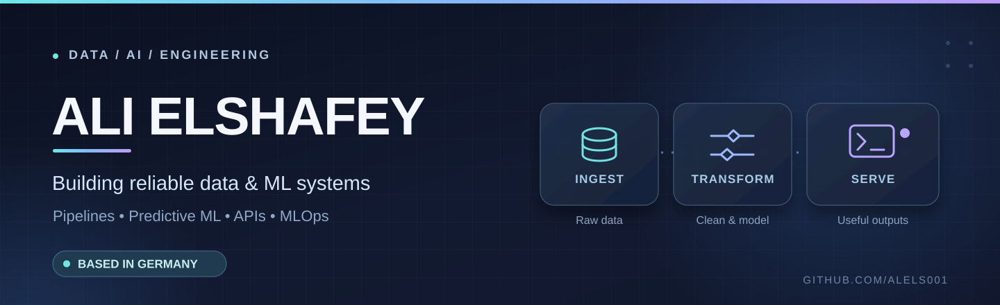

<div align="center">
  

  ### Data Science graduate · M.Sc. Computer Science student · Germany

  **Building practical data pipelines, ML systems, and AI applications.**

  [](https://github.com/alels001?tab=repositories)
  [](https://www.linkedin.com/in/ali-elshafey-5360641b9)
</div>

---

## About me

I'm **Ali Elshafey**, a Data Science graduate from **FH Dortmund** and currently a master's student in **Computer Science** in Germany. I enjoy working across the data lifecycle: ingestion, cleaning, transformation, modelling, evaluation, and deployment.

My projects range from **Spark-based data engineering** to predictive maintenance and LLM applications. I focus on making systems testable, reproducible, and useful beyond a notebook.

## Selected projects

<table>
<tr>
<td width="50%" valign="top">

### 01 · [Open Food Facts Lakehouse](https://github.com/alels001/etl-data-pipeline)

A batch data pipeline that extracts data from Open Food Facts and processes it through a **Bronze → Silver → Gold** lakehouse with incremental loading, data-quality checks, and analytical tables. Includes tests, CI, and an Airflow DAG.

`Python` `PySpark` `Delta Lake` `ETL` `Airflow`

</td>
<td width="50%" valign="top">

### 02 · [NASA Predictive Maintenance](https://github.com/alels001/rul-prediction-cmapss-fd001)

Remaining Useful Life prediction on the NASA C-MAPSS FD001 dataset. A controlled comparison of regression, gradient boosting, and sequence models, with engine-level validation and reproducible experiments.

`Python` `XGBoost` `Time Series` `ML Evaluation`

</td>
</tr>
<tr>
<td width="50%" valign="top">

### 03 · [PolicyPilot](https://github.com/alels001/policy-pilot)

An evolving internal-document question-answering project exploring ingestion, retrieval, role-aware document access, and API-based delivery.

`Python` `PostgreSQL` `pgvector` `RAG`

</td>
<td width="50%" valign="top">

### 04 · [German Crossword Solver](https://github.com/alels001/crossword-solver)

From crossword photos to structured puzzles and candidate solutions, combining computer vision, OCR, retrieval, language models, and constraint solving. Includes API tooling and evaluation.

`Python` `Computer Vision` `LLMs` `FastAPI`

</td>
</tr>
</table>

**Other projects:** [Customer Churn Prediction](https://github.com/alels001/customer-churn-prediction) · [NBA Salary Prediction](https://github.com/alels001/nba-salary-prediction)

## Technology

| Focus | Tools and concepts |
|:--|:--|
| **Data engineering** | Python, SQL, pandas, PySpark, Apache Spark, Delta Lake, ETL, Medallion architecture |
| **Databases & retrieval** | PostgreSQL, SQLite, pgvector, embeddings, RAG |
| **Machine learning** | scikit-learn, XGBoost, LightGBM, PyTorch, time-series evaluation |
| **Engineering** | Docker, FastAPI, Git, REST APIs, pytest, GitHub Actions |

**Currently learning more about:** AWS data services, distributed data platforms, Kubernetes, and production lakehouse operations.

## How I build

```text
Source data → Ingest → Validate & transform → Model or analyse → Serve
                         ↕                      ↕
                    Data quality           Evaluation
```

I prefer clearly scoped projects, documented decisions, and measurable results—especially when simpler approaches can solve the problem well.

<details>
<summary><b>GitHub activity</b></summary>
<br />
<div align="center">
  
</div>
<sub>Live statistics are loaded from an external service and may occasionally be unavailable.</sub>
</details>

---

<div align="center">

**Interested in data platforms, reliable ML, and useful AI products.**

[Explore my repositories](https://github.com/alels001?tab=repositories) · [Connect on LinkedIn](https://www.linkedin.com/in/ali-elshafey-5360641b9)

</div>
